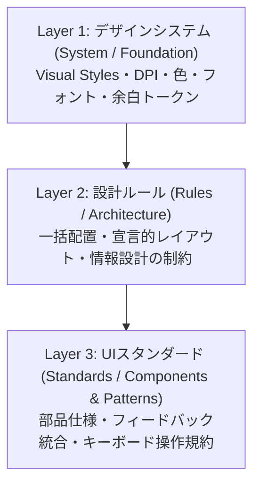

# UI_UPDATE_20261123: ChatPalette UI/UX 設計・刷新計画

## 1. 計画概要

### 1.1 目的
ChatPalette デスクトップ UI（`src/desktop/`）における描画品質・レイアウト保守性・操作体験の構造的課題を解消し、**審美性（Aesthetics）・有用性（Utility）・シンプリシティ（Simplicity）**を体系的に引き上げる。

### 1.2 対象範囲
- **パレット画面**: `src/desktop/palette.zig`
- **管理画面・編集ダイアログ**: `src/desktop/management.zig`
- **管理・ヘルプ画面**: `src/desktop/support.zig`
- **リアクション進行画面**: `src/desktop/reaction_progress.zig`
- **ステータス通知**: `src/desktop/status_tip.zig`
- **共通描画・DPI・レイアウト基盤**: `src/desktop/win.zig`, `src/desktop/viewport.zig`, `build.zig`

### 1.3 現状の構造的課題
1. **背景色と子コントロール色の不整合**: ウィンドウ背景に `COLOR_WINDOW`（白）を指定しつつ `WM_CTLCOLORSTATIC` 等を未処理のため、`STATIC` ラベルが `COLOR_3DFACE`（灰）の矩形として浮く。
2. **ちらつき・残像**: `viewport.zig` がコントロール1つずつ `MoveWindow(..., 1)` を即時再描画付きで呼び出し、`WS_CLIPSIBLINGS` も未設定のため、リサイズ・スクロール時に激しいちらつきと描き残しが発生する。
3. **Visual Styles 未適用**: アプリケーションマニフェストが存在せず、ComCtl32 v6 が有効化されていないため、クラシック外観で描画される。
4. **マジックナンバー座標と文字切れ**: `palette.zig` 等のレイアウトが手動オフセット計算と固定ピクセル高さに依存しており、テキスト量やフォント変化で崩れやすい。
5. **System DPI 固定**: `DPI_AWARENESS_CONTEXT_SYSTEM_AWARE` 固定かつ `WM_DPICHANGED` 未処理のため、マルチモニタ環境でビットマップ拡大縮小によるぼやけが生じる。
6. **情報過多**: パレット画面に主機能・補助設定・3本の通知欄が同列に並び、視線誘導と縦スペースの効率が悪い。

---

## 2. UI/UX 設計の3層アーキテクチャ

---

### Layer 1: デザインシステム（System / Foundation）
アプリ全体の視覚的一貫性と OS ネイティブ品質を担保する不変の基盤。

#### 1.1 OS 描画基盤・DPI
- **マニフェスト組み込み**: `build.zig` から Windows リソースとしてマニフェストを埋め込み、以下を宣言する。
  - `Microsoft.Windows.Common-Controls` version `6.0.0.0`（Visual Styles 有効化）
  - `<dpiAwareness>PerMonitorV2</dpiAwareness>`（Per-Monitor DPI v2 有効化）
- **動的 DPI 追従**: 各トップレベルウィンドウが `WM_DPICHANGED` を処理し、新しい DPI でフォント群を再生成して再レイアウトを実行する。

#### 1.2 サーフェスとカラートークン
| トークン | Win32 値 | 用途 |
|---|---|---|
| `surface.window` | `COLOR_3DFACE` | ダイアログ・ウィンドウの基本背景面 |
| `surface.field` | `COLOR_WINDOW` | テキスト入力・リスト・プレビューの背景面 |
| `text.primary` | `COLOR_WINDOWTEXT` | 見出し・本文・主要ラベル |
| `text.muted` | `COLOR_GRAYTEXT` | 補足ヒント・状態表示 |

- 全ウィンドウ共通の `WM_CTLCOLORSTATIC` / `WM_CTLCOLORBTN` ハンドラを提供し、背景面（`surface.window`）とコントロール背景色・ブラシを常に一致させる。

#### 1.3 タイポグラフィトークン
`Yu Gothic UI` を基準に、役割別の3段階フォントを `GuiFontSet` として管理する。
- **Heading**: 10.5pt SemiBold（セクション見出し）
- **Body**: 9.5pt Regular（通常コントロール・リスト・本文）
- **Caption**: 8.5pt Regular（補足ヒント・ステータス）
- コントロールの基準高さは固定値ではなく、`GetTextMetricsW` で取得した行高 + 上下パディングから算出する。

#### 1.4 スペーシンググリッド（4 DIP 基準）
すべての余白は論理単位（DIP: 96 DPI 基準）で以下のトークンのみを使用する。
- `space.xs = 4`（ラベルと直下コントロールの間）
- `space.sm = 8`（同一グループ内のコントロール間）
- `space.md = 12`（ウィンドウ外周パディング）
- `space.lg = 16`（セクション間の区切り）

---

### Layer 2: 設計ルール（Rules / Architecture）
描画の破綻・ちらつき・複雑化を構造的に防ぐ実装ルール。

#### 2.1 ゼロ・フリッカー描画ルール
- **一括配置の強制**: レイアウト時の個別 `MoveWindow(..., 1)` を禁止し、`BeginDeferWindowPos` → `DeferWindowPos` → `EndDeferWindowPos` で全コントロールを1回の再描画トランザクションで移動する。
- **クリッピング標準化**: 親ウィンドウに `WS_CLIPCHILDREN`、すべての子コントロールに `WS_CLIPSIBLINGS` を必ず付与する。
- **1パス確定**: `Viewport` はスクロールバー有無の判定と配置計算を1パスで完結させ、不要な再帰リフローを排除する。

#### 2.2 宣言的レイアウトのルール（脱マジックナンバー）
- 手動の絶対座標計算（例: `93 + below_list`, `list_top - 85`）を禁止する。
- 共通レイアウトモジュール（`layout.zig`）に以下のプリミティブを導入する。
  - `VStack`: 子要素を上から順に `gap` 間隔で積む。非表示（`visible == false`）の要素は高さを `0` として自動的に詰める。
  - `HStack`: 子要素を左から右へ並べ、固定幅と可変幅（`flex`）を自動配分する。
  - `Flex`: ウィンドウの残り高さをリストやプレビューへ割り当てる。

#### 2.3 情報設計・シンプリシティのルール
- **1画面1主目的**: パレット画面の主導線を「配信者選択 → 検索 → 弾幕選択 → 入力」に明確化し、画面上部から中央をこの導線に割り当てる。
- **プログレッシブ・ディスクロージャー**: 補助機能（リアクション詳細設定、標準設定の保存/読込）は明確なセクション区切りで分離し、使用頻度の低い操作や空のヒント領域が主導線を圧迫しない構成とする。

---

### Layer 3: UI スタンダード（Standards / Components & Patterns）
全画面で一貫した操作感・見た目を維持するための統一基準。

| 領域 | スタンダード |
|---|---|
| **ボタン階層** | 1画面につき主ボタン（`BS_DEFPUSHBUTTON`）は1つのみ。破壊的操作・補助操作は視覚的に分離する。 |
| **通知・フィードバック** | 複数乱立している通知ラベル（`message`, `reaction_notice`, `settings_notice`）を、**①単一のステータス行（常駐状態）＋ ②必要時のみ表示するインライン警告バナー ＋ ③`StatusTip`（一時トースト）** の3役割に整理する。 |
| **コンボボックス** | レイアウト計算上の高さは「1行分（フォント基準）」とし、ドロップダウン展開高さは Win32 配置時のみ加算する。 |
| **キーボード操作** | `Tab` 移動順は視覚的な左上→右下と完全一致させる。`Esc` で閉じる、`Enter` で主アクション実行を全ウィンドウで統一する。 |

---

## 3. マイルストーン計画

既存テスト（`zig build test` および各種統合テスト）の通過を各マイルストーンの必須条件とし、段階的に移行する。

### M1: 描画基盤とデザインシステムの確立
- **目的**: Visual Styles・Per-Monitor DPI v2・色/フォント/余白トークンを共通基盤として導入し、外観の違和感（クラシック表示・ラベル背景浮き・高DPIぼやけ）を解消する。
- **主な変更対象**:
  - `build.zig`, 新規マニフェスト/リソースファイル（`src/desktop/app.manifest`, `app.rc` 等）
  - `src/desktop/win.zig`（`PerMonitorV2` 対応、`GuiFontSet`、メトリクス算出、共通 `WM_CTLCOLOR*` ヘルパー）
- **完了条件**:
  - ビルド成果物にマニフェストが埋め込まれ、ComCtl32 v6 外観で起動すること。
  - 全ウィンドウで `STATIC` ラベルの背景色がウィンドウ背景と一致すること。
  - DPI 変更（`WM_DPICHANGED`）時のフォント再生成・スケーリングが単体テストで検証されていること。

### M2: ゼロ・フリッカー描画と宣言的レイアウトエンジンの構築
- **目的**: ちらつき・残像の根本原因を取り除き、マジックナンバー無しでレイアウトを記述できる共通エンジンを整備する。
- **主な変更対象**:
  - `src/desktop/viewport.zig`（`BeginDeferWindowPos` 一括配置化、`WS_CLIPSIBLINGS` 標準化、1パス化）
  - 新規 `src/desktop/layout.zig`（`VStack` / `HStack` / `Flex` プリミティブと DIP トークン）
- **完了条件**:
  - `layout.zig` の座標計算・非表示要素の自動詰め・余白配分・コンボボックス高さ分離がヘッドレス単体テストで検証されていること。
  - `Viewport` の一括配置が既存デスクトップテストを壊さず動作すること。

### M3: パレット画面（Palette）の再設計と移行
- **目的**: 最重要画面であるパレット画面を新レイアウトエンジン・新スタンダードへ移行し、審美性・有用性・シンプリシティを大幅に改善する。
- **主な変更対象**:
  - `src/desktop/palette.zig`
- **完了条件**:
  - `palette.zig` の `layout()` からマジックナンバー座標計算が撤廃され、`layout.zig` ベースに置き換わっていること。
  - 3本の通知ラベルが単一ステータス行＋条件付き警告バナーに整理され、空領域の間延びが解消されていること。
  - リサイズ・スクロール・DPI 変更時にちらつきや要素重なりが発生しないこと。
  - 既存のパレット関連テストがすべて通過すること。

### M4: 管理画面・サポート画面・補助UIの移行
- **目的**: パレット以外の全画面に同一のデザインシステム・ルール・スタンダードを適用し、アプリ全体の一貫性を完成させる。
- **主な変更対象**:
  - `src/desktop/management.zig`（管理画面＋編集ダイアログ）
  - `src/desktop/support.zig`
  - `src/desktop/reaction_progress.zig`
  - `src/desktop/status_tip.zig`
- **完了条件**:
  - 全画面が `GuiFontSet`・共通色ハンドラ・`layout.zig`・一括配置を使用していること。
  - 全画面で `WM_DPICHANGED` とキーボード操作スタンダード（Tab 順・Esc・Enter）が統一されていること。
  - 管理画面・サポート画面の既存テストがすべて通過すること。

### M5: 統合検証と品質保証
- **目的**: 実環境相当の条件で描画・操作・性能・回帰の最終確認を行う。
- **検証項目**:
  - `zig build test`（ヘッドレス・デスクトップ両方）および統合テスト群の全通過。
  - 複数 DPI（100% / 125% / 150% / 200%）およびモニタ間移動での表示・文字切れ・ぼやけ確認。
  - 連続リサイズ・ホイールスクロール時のちらつき・残像の目視確認および `chatpalette-benchmark-ui` による性能確認。
- **完了条件**:
  - すべての自動テストが通過し、設計書に記載した課題6項目が解消されていること。

---

## 4. リスクと対策

| リスク | 影響 | 対策 |
|---|---|---|
| マニフェスト導入による既存コントロール寸法の微変 | 一部の既存デスクトップテストで座標・サイズ前提が外れる可能性 | M1 時点で全テストを実行し、テスト側のハードコード前提があれば新メトリクス基準に合わせて整理する。 |
| パレット通知欄の統合による既存テスト・呼び出し元の変更 | `message` / `reaction_notice` / `settings_notice` を参照する箇所の修正が必要 | M3 着手前に呼び出し元とテストの依存を洗い出し、表示優先度ルールを明文化してから統合する。 |
| `PerMonitorV2` 移行時の `StatusTip`・サブウィンドウ座標ずれ | マルチモニタ環境での表示位置ずれ | モニタごとの DPI（`GetDpiForMonitor` / `GetDpiForWindow`）を基準に計算するよう統一する。 |

---

## 5. 完了実績（v0.9.3 / 2026-11-23）

| マイルストーン | 状態 | 主な成果物 |
|---|---|---|
| M1: 描画基盤とデザインシステムの確立 | 完了 | `src/desktop/app.manifest`, `src/desktop/app.rc`, `build.zig`, `src/desktop/win.zig` |
| M2: ゼロ・フリッカー描画と宣言的レイアウト構築 | 完了 | `src/desktop/layout.zig`, `src/desktop/viewport.zig` |
| M3: パレット画面の再設計と移行 | 完了 | `src/desktop/palette.zig` |
| M4: 管理・サポート・補助UIの移行 | 完了 | `src/desktop/management.zig`, `src/desktop/support.zig`, `src/desktop/reaction_progress.zig`, `src/desktop/status_tip.zig` |
| M5: 統合検証と品質保証 | 完了 | `zig build install tools test`・`source-check`・`ChatPalette.exe --smoke`・`chatpalette-benchmark-ui`（1,000〜100,000件）全通過 |

### 備考（配布スナップショット対応）
`src/desktop/app.rc` および `src/desktop/app.manifest` の追加に伴い、`tools/release.zig` と `tools/source_check.zig` を更新し、配布候補固定（`freeze`）のソーススナップショットと `SOURCE-SHA256SUMS` に `src/` 配下の `.rc`・`.manifest` が含まれるよう整合させた。
